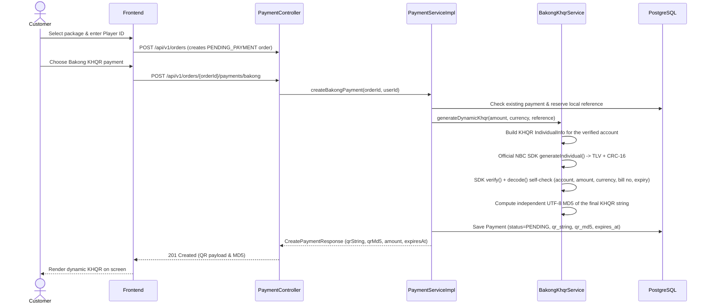
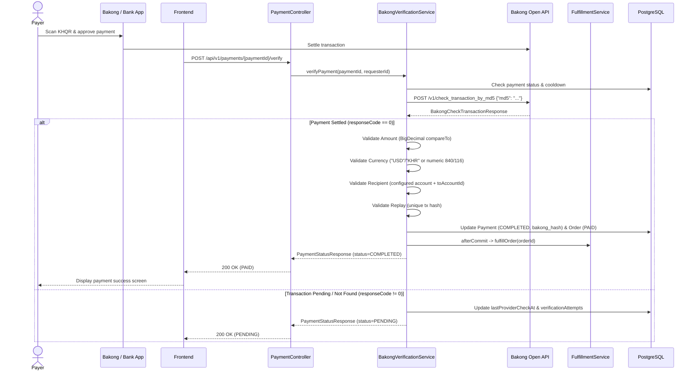
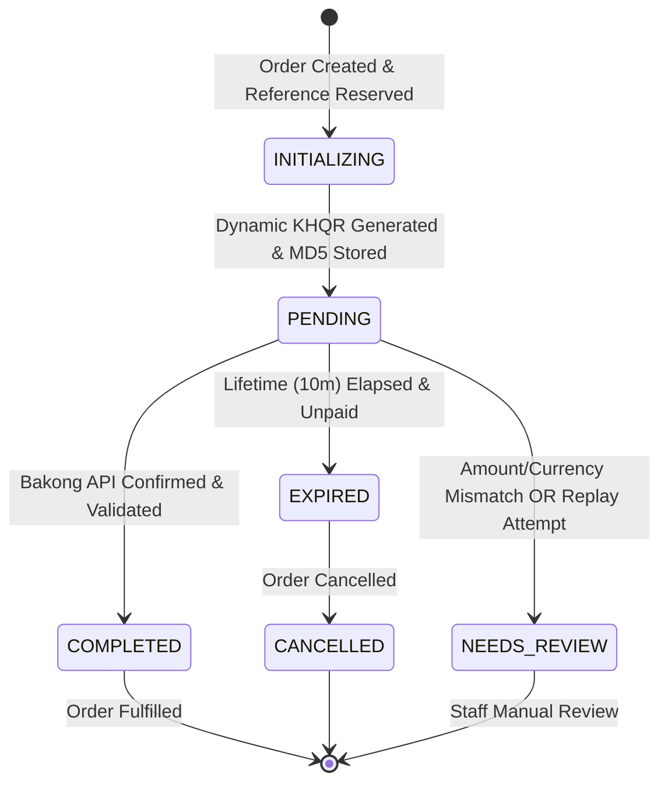

# Bakong KHQR Payment Integration — GameTopUp-KH

This document details the Bakong KHQR (Khmer Quick Response) payment integration for the GameTopUp-KH Spring Boot backend.

---

## 1. Module Architecture

The Bakong integration module is located in `org.example.gametopupkh.payment.bakong`:

```text
payment/bakong/
├── dto/
│   ├── BakongKhqrResponse.java           # DTO containing KHQR payload, MD5, expiration, amount, currency
│   ├── BakongCheckTransactionRequest.java # Request payload ({"md5": "..."}) for check_transaction_by_md5
│   ├── BakongCheckTransactionResponse.java# Typed response from Bakong Open API
│   ├── BakongCheckAccountRequest.java    # Request payload ({"accountId": "..."}) for check_bakong_account
│   ├── BakongCheckAccountResponse.java   # Typed response from check_bakong_account
│   ├── BakongAccountVerificationResponse.java # Staff-facing verification result
│   └── BakongKhqrOrderRequest.java       # Request payload for /api/v1/payments/bakong/khqr
├── BakongProperties.java                 # Configuration properties, domain validation, secret masking
├── BakongKhqrService.java               # Official NBC SDK wrapper, self-validating dynamic KHQR generator & MD5 hasher
├── BakongApiClient.java                 # HTTP RestClient transport for check_transaction_by_md5 and check_bakong_account
├── BakongPaymentGateway.java             # Implements PaymentGateway abstraction (active when payment.gateway=bakong)
├── BakongPaymentMapper.java              # Maps Bakong Open API responses to domain PaymentIntents
└── BakongVerificationService.java        # Authoritative transaction verifier, replay preventer, and fulfillment initiator
```

KHQR codes are generated with the **official National Bank of Cambodia SDK**
(`kh.gov.nbc.bakong_khqr:sdk-java:1.0.0.15`, Maven Central). The service never
hand-assembles EMVCo TLV data. It builds an SDK `IndividualInfo`, generates the
code, then independently re-verifies the CRC-16 checksum and decodes the result
to prove the account, amount, currency, bill number and expiry actually survived
before returning the QR to a customer. The SDK's unused deep-link transport
(OkHttp/Gson) and URL validator are excluded from the build.

### Architectural Principles

1. **Separation of Concerns**: Generating a dynamic KHQR is not proof of payment. Payment is only confirmed (`PAID`) when verified authoritatively against the Bakong Open API.
2. **Fail-Closed Generation**: In production, KHQR generation returns `503 BAKONG_PAYMENT_DISABLED` while `BAKONG_PAYMENT_ENABLED=false`, even if a caller reaches the Bakong endpoint. There is no placeholder or sandbox-account fallback: generation also refuses to run without a configured `BAKONG_ACCOUNT_ID`.
3. **Replay Protection**: The returned transaction hash (`data.hash`) is stored in both `payments.gateway_reference` and `payments.bakong_hash`. A database-level partial unique index (`uq_payments_bakong_hash`) strictly prevents reusing a transaction hash across multiple payments or orders.
4. **Double Fulfillment Prevention**: The `COMPLETED` payment status transition is transactional. Automated fulfillment through `FulfillmentService` is triggered only after the transaction commits, using `TransactionSynchronization.afterCommit` in a `REQUIRES_NEW` boundary. Repeated verification calls return the persisted state idempotently without re-triggering fulfillment.
5. **Defense in Depth**: Monetary amount (`BigDecimal.compareTo`), currency (`USD`/`KHR`, also accepting Bakong numeric `840`/`116`), receiving account ID (`toAccountId`), and transaction uniqueness are all strictly validated before payment is marked complete. Recipient validation fails closed: if the configured merchant account ID or the provider's `toAccountId` is missing, the payment is placed into `NEEDS_REVIEW` instead of being accepted. If any validation fails, the payment and order are placed into `NEEDS_REVIEW` for human investigation.
6. **Rate Limiting & Cooldown**: Verification requests are protected by a configurable per-payment cooldown (`payment.reconcile.cooldown`) to protect the Bakong Open API quota and prevent excessive polling.
7. **Account Verification**: Staff can call `GET /api/v1/admin/payments/bakong/account` to run Bakong's read-only `check_bakong_account` lookup against the configured merchant account. The result is advisory (`verified=false` on a non-zero provider response code) and no money moves.
8. **Bounded Retries**: `payment.bakong.max-retries` (default `2`) applies only to transient read-only failures: network/timeouts and HTTP 5xx. Authentication, 4xx validation and rate-limit (429) responses are never retried.

---

## 2. Configuration & Environment Variables

The following environment variables configure the Bakong integration:

| Environment Variable | Application Property | Default | Description |
| :--- | :--- | :--- | :--- |
| `BAKONG_ENVIRONMENT` | `payment.bakong.environment` | `production` | Environment mode (`production` or `sandbox`). |
| `BAKONG_PAYMENT_ENABLED` | `payment.bakong.enabled` | `false` | Master kill-switch. Keeps live payments disabled until credentials are fully authorized. |
| `BAKONG_BASE_URL` | `payment.bakong.base-url` | `https://api-bakong.nbc.gov.kh` for `production`, `https://sit-api-bakong.nbc.org.kh` for `sandbox` | Base URL for Bakong Open API. Validated against approved NBC domains. |
| `BAKONG_API_TOKEN` | `payment.bakong.api-token` | `""` | Bearer API token obtained from NBC Bakong developer portal. Redacted in logs. |
| `BAKONG_ACCOUNT_ID` | `payment.bakong.account-id` | `""` | Merchant receiving Bakong account ID (e.g. `merchant@bank` or mobile number). |
| `BAKONG_MERCHANT_NAME` | `payment.bakong.merchant-name` | `GameTopUp-KH` | Display name of the store appearing on payer banking apps (max 25 chars). |
| `BAKONG_MERCHANT_CITY` | `payment.bakong.merchant-city` | `Phnom Penh` | Merchant city for EMVCo Tag 60 (max 15 chars). |
| `BAKONG_LIFETIME_MINUTES` | `payment.bakong.lifetime-minutes` | `10` | KHQR expiration window (capped at maximum 10 minutes per Bakong specification). |
| `BAKONG_CONNECT_TIMEOUT` | `payment.bakong.connect-timeout` | `5s` | HTTP connect timeout to Bakong Open API. |
| `BAKONG_READ_TIMEOUT` | `payment.bakong.read-timeout` | `15s` | HTTP socket read timeout. |
| `BAKONG_MAX_RETRIES` | `payment.bakong.max-retries` | `2` | Bounded retries for transient read-only failures (network/timeouts and HTTP 5xx). Auth, 4xx and 429 are not retried. |

---

## 3. KHQR Generation Flow (EMVCo Specification)

When a customer initiates a top-up with Bakong KHQR:



### EMVCo TLV Format (as emitted by the official SDK):
- **Tag 00** (Payload Format Indicator): `"01"` -> `000201`
- **Tag 01** (Point of Initiation Method): `"12"` (Dynamic QR: amount is pre-filled and locked) -> `010212`
- **Tag 29** (Merchant Account Info - Individual/Solo):
  - Subtag 00: Bakong Account ID (`properties.accountId()`)
- **Tag 52** (Merchant Category Code): `"5999"` (Miscellaneous Retail) -> `52045999`
- **Tag 53** (Transaction Currency): ISO 4217 numeric code (`840` for USD, `116` for KHR)
- **Tag 54** (Transaction Amount): Exact monetary string from the database (e.g. `4.25`)
- **Tag 58** (Country Code): `"KH"` -> `5802KH`
- **Tag 59** (Merchant Name): Registered store name (e.g. `GameTopUp-KH`, max 25 chars)
- **Tag 60** (Merchant City): Registered city (e.g. `Phnom Penh`, max 15 chars)
- **Tag 62** (Additional Data Field Template):
  - Subtag 01 (Bill Number): Local payment reference or order number
- **Tag 99** (Timestamp): SDK-provided creation/expiration timestamps when an
  expiration window is configured. The configured lifetime is capped at 10 minutes.
- **Tag 63** (CRC-16 Checksum): 4-digit hexadecimal CRC-16/CCITT-FALSE (poly: `0x1021`, init: `0xFFFF`) calculated over the complete payload including `6304`.

The **QR MD5 hash** is calculated independently as standard MD5 over the final
complete KHQR UTF-8 string (32 lowercase hex characters) and stored in
`payments.qr_md5` for `check_transaction_by_md5`.

### Monetary precision
The database stores money as `NUMERIC(12,2)` / `BigDecimal`. The SDK only accepts
`Double`, so conversion happens once at the SDK boundary. KHR amounts must be
whole riel (KHQR forbids KHR decimals) and USD amounts may have at most two
decimals; the decoded QR is then compared back to the original `BigDecimal`, so a
conversion error can never be returned to a customer.

---

## 4. Payment Verification Flow

The customer scans the QR with any Bakong-enabled banking app. The frontend or scheduled worker queries verification:



### Scheduled reconciliation

`PaymentReconciliationService` runs on `payment.reconciliation.*` and includes
`BAKONG` candidates **independently of the active storefront gateway**. This means
Bakong payments are still reconciled when `PAYMENT_GATEWAY=mock` or `aba`, because
Bakong verification uses its own MD5 check rather than the active gateway bean.
ABA candidates are included only when ABA is the active gateway. Each candidate
goes through the same cooldown, amount/currency/recipient/replay validation and
after-commit fulfillment path as an interactive verification, so reconciliation
cannot bypass the payment state machine. Production leaves the scheduler disabled
(`PAYMENT_RECONCILIATION_ENABLED=false`) until a live gateway is approved.

---

## 5. Payment Status Lifecycle



---

## 6. API Endpoints

### 1. Initialize Bakong KHQR Payment (Path A - Standard Order Context)
`POST /api/v1/orders/{orderId}/payments/bakong`
- **Auth**: `Bearer <customer_token>`
- **Response** (`201 Created`):
```json
{
  "success": true,
  "data": {
    "paymentId": "550e8400-e29b-41d4-a716-446655440000",
    "orderId": "6ba7b810-9dad-11d1-80b4-00c04fd430c8",
    "provider": "BAKONG",
    "reference": "X8K9L2M4N7P1Q5R3T0V6",
    "status": "PENDING",
    "amount": 4.25,
    "currency": "USD",
    "qrString": "00020101021229200016merchant@bank52045999530384054044.255802KH5912GameTopUp-KH6010Phnom Penh62150111ORDER-123456304ABCD",
    "qrMd5": "e4d909c290d0fb1ca068ffaddf22cbd0",
    "expiresAt": "2026-11-02T03:34:00Z",
    "createdAt": "2026-11-02T03:24:00Z"
  }
}
```

### 2. Initialize Bakong KHQR Payment (Path B - Direct Payment Context)
`POST /api/v1/payments/bakong/khqr`
- **Auth**: `Bearer <customer_token>`
- **Request Body**:
```json
{
  "orderId": "6ba7b810-9dad-11d1-80b4-00c04fd430c8"
}
```
- **Response**: `201 Created` with `CreatePaymentResponse`.

### 3. Read Payment by ID
`GET /api/v1/payments/{paymentId}`
- **Auth**: `Bearer <customer_token>` (order owner or `ROLE_ADMIN`)
- **Response**: `200 OK` with `PaymentStatusResponse`.

### 4. Verify Payment with Provider
`POST /api/v1/payments/{paymentId}/verify`
- **Auth**: `Bearer <customer_token>` (order owner or `ROLE_ADMIN`)
- **Response** (`200 OK`):
```json
{
  "success": true,
  "data": {
    "paymentId": "550e8400-e29b-41d4-a716-446655440000",
    "orderId": "6ba7b810-9dad-11d1-80b4-00c04fd430c8",
    "provider": "BAKONG",
    "reference": "X8K9L2M4N7P1Q5R3T0V6",
    "gatewayReference": "b5d8c1e2f3a4b5c6d7e8f9a0b1c2d3e4f5a6b7c8d9e0f1a2b3c4d5e6f7a8b9c0",
    "bakongHash": "b5d8c1e2f3a4b5c6d7e8f9a0b1c2d3e4f5a6b7c8d9e0f1a2b3c4d5e6f7a8b9c0",
    "status": "COMPLETED",
    "amount": 4.25,
    "currency": "USD",
    "paidAt": "2026-11-02T03:25:30Z",
    "expiresAt": "2026-11-02T03:34:00Z",
    "createdAt": "2026-11-02T03:24:00Z",
    "updatedAt": "2026-11-02T03:25:30Z"
  }
}
```

### 5. Verify Merchant Account (Admin)
`GET /api/v1/admin/payments/bakong/account`
- **Auth**: `Bearer <admin_token>` (`ROLE_ADMIN`)
- **Purpose**: Runs the read-only Bakong `POST /v1/check_bakong_account` lookup against `BAKONG_ACCOUNT_ID`.
- **Response** (`200 OK`):
```json
{
  "success": true,
  "data": {
    "accountId": "merchant@bank",
    "verified": true,
    "responseCode": 0,
    "responseMessage": "Success"
  }
}
```
A non-zero `responseCode` (for example `11` account not found) returns `verified: false` for investigation. Missing configuration returns `400 BAKONG_ACCOUNT_ID_MISSING`; an unreachable provider returns `502 PAYMENT_PROVIDER_UNAVAILABLE`.

---

## 7. Local Testing & Mocking

All unit, gateway, API, and verification tests run locally without contacting the live NBC Bakong network:

1. **Run All Bakong Module Tests**:
   ```powershell
   .\mvnw test -Dtest=Bakong*
   ```
2. **Run Full Test Suite with Real PostgreSQL Container**:
   ```powershell
   .\mvnw test
   ```

In automated tests:
- `BakongKhqrService` calls the **real official SDK** locally and asserts EMVCo structure, CRC-16 validity, decoded account/amount/currency/bill number/expiry, MD5 correctness, the production-disabled gate, and KHR/currency precision rules.
- `BakongApiClient` uses Spring's `MockRestServiceServer` to test API status codes, error handling, rate limiting, retries, account lookup, and network timeouts. No outbound Bakong request is made.
- `BakongVerificationService` runs against mocked provider responses, verifying database constraints, atomic status updates, fail-closed recipient validation, replay detection, numeric currency normalisation, and automated fulfillment invocation.
- `PaymentReconciliationServiceTests` proves Bakong payments are reconciled when the default gateway is `mock`.

For the common failure paths, the expected behaviour is:

| Case | Result |
| :--- | :--- |
| Unknown/invalid MD5 (not yet paid) | `PENDING`, `lastProviderCheckAt` and `verificationAttempts` updated |
| Amount or currency mismatch | Payment `NEEDS_REVIEW`, order `NEEDS_REVIEW`, no fulfillment |
| Recipient missing or different | Payment `NEEDS_REVIEW`, order `NEEDS_REVIEW`, no fulfillment |
| Transaction hash already used | Replay rejected, payment `NEEDS_REVIEW` |
| Already `COMPLETED` | Idempotent response; fulfillment not repeated |
| 401/403/429/4xx from Bakong | No retry; surfaced as provider error/throttle |
| Network timeout or 5xx | Bounded retries (`BAKONG_MAX_RETRIES`), then provider unavailable |

---

## 8. Production Deployment & Readiness Checklist

Before activating live Bakong payments in production (`BAKONG_PAYMENT_ENABLED=true`):

- [ ] **Rotate Exposed Token**: Request and obtain a newly generated production Bearer token from the NBC Bakong developer portal to replace any previously compromised token.
- [ ] **Confirm Merchant Account Verification**: Ensure NBC has completed mobile KYC / corporate account verification for the receiving Bakong Account ID.
- [ ] **Run Account Check**: With credentials configured, call `GET /api/v1/admin/payments/bakong/account` as an admin and confirm `verified=true`. In production, all Bakong provider calls (including this read-only check) fail closed while `BAKONG_PAYMENT_ENABLED=false`, so perform the check in sandbox first, or during a short production pre-flight window with the switch on and no customer orders created.
- [ ] **Configure Environment Variables**:
  - `BAKONG_ENVIRONMENT=production`
  - `BAKONG_BASE_URL=https://api-bakong.nbc.gov.kh`
  - `BAKONG_API_TOKEN=<NEW_UNCOMPROMISED_TOKEN>`
  - `BAKONG_ACCOUNT_ID=<VERIFIED_ACCOUNT_ID>`
  - `BAKONG_MERCHANT_NAME=GameTopUp-KH`
  - `BAKONG_MERCHANT_CITY=Phnom Penh`
  - `BAKONG_PAYMENT_ENABLED=true`
  - `PAYMENT_RECONCILIATION_ENABLED=true` (only once a live gateway is approved)
- [ ] **Keep the Supplier Disabled**: `SUPPLIER_CLIENT=mock` and `BAY2GAME_ENABLED=false` until an authorized supplier agreement exists. Live payment does not authorize live diamond delivery.
- [ ] **Review Quota & Rate Limits**: Confirm NBC commercial Open API rate limits and ensure `payment.reconcile.cooldown` (default: 30s) prevents quota exhaustion.
- [ ] **Database Migration V13 Verified**: Migration `V13__add_bakong_payment_support.sql` applies successfully, establishing `uq_payments_bakong_hash` and updating `payments_provider_chk`.
- [ ] **Security Review**: Tokens must remain purely on the backend process environment. Never expose `BAKONG_API_TOKEN` to frontend, repository commits, or logs.

---

## 9. Gated Live-Test Procedure (one explicitly approved small-value payment)

Do **not** run this during normal development. It requires the user's explicit
approval and a real NBC-issued sandbox/production credential with a verified
receiving account. Every step below is manual and reversible.

1. **Preconditions (all must be true)**
   - Token rotation is complete and the new token has never been committed or logged.
   - `GET /api/v1/admin/payments/bakong/account` returns `verified=true`.
   - `SUPPLIER_CLIENT=mock`; real diamond delivery stays off.
   - A dedicated test order exists with a deliberately small amount (for example USD 0.10 or KHR 500) and the lowest-value package.
   - You have an approved test payer account and can manually approve exactly one QR payment.

2. **Point at sandbox first**
   - `BAKONG_ENVIRONMENT=sandbox`
   - `BAKONG_BASE_URL=https://sit-api-bakong.nbc.org.kh`
   - `BAKONG_PAYMENT_ENABLED=true`
   - `PAYMENT_GATEWAY=mock` (Bakong can still be exercised through the explicit `/payments/bakong` endpoints)
   - `PAYMENT_RECONCILIATION_ENABLED=false`
   - Restart the application and confirm startup validation passes.

3. **Generate the QR**
   - `POST /api/v1/orders/{orderId}/payments/bakong` as the order owner.
   - Record the returned `paymentId`, `reference`, `qrMd5`, `amount`, `currency` and `expiresAt`.
   - Confirm the returned `qrString` is a dynamic code (`010212`) whose Tag 54 amount equals the order total and whose Tag 53 currency matches.

4. **Pay exactly once**
   - Scan the QR with the approved payer app and approve the exact amount shown.
   - Do not retry the transfer, do not edit the amount, and do not reuse the QR.

5. **Verify**
   - `POST /api/v1/payments/{paymentId}/verify` as the order owner.
   - Expected: `status=COMPLETED`, `orderStatus=PAID`, and `bakongHash` populated.
   - Confirm the supplier side stayed mock: fulfillment should complete with the mock supplier only.
   - Call verify again and confirm the response is idempotent and fulfillment is not repeated.

6. **Abort / rollback**
   - Immediately set `BAKONG_PAYMENT_ENABLED=false` if any mismatch appears.
   - If the payment is `NEEDS_REVIEW`, do not manually mark it PAID; capture the payment ID, MD5, transaction hash and provider response for investigation.
   - If no payment is made, let the QR expire and confirm the order transitions to `EXPIRED`/`CANCELLED` per the normal timeout job.

7. **After the test**
   - Export the payment, order-status-history and fulfillment records for the test order.
   - Re-disable live Bakong (`BAKONG_PAYMENT_ENABLED=false`) unless a separate decision approves ongoing collection.
   - Never paste the API token or full provider payloads containing personal data into tickets.
