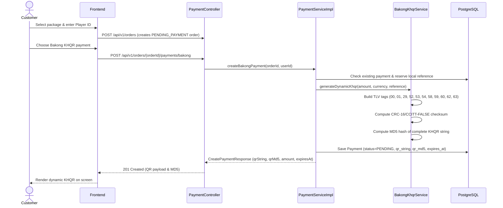
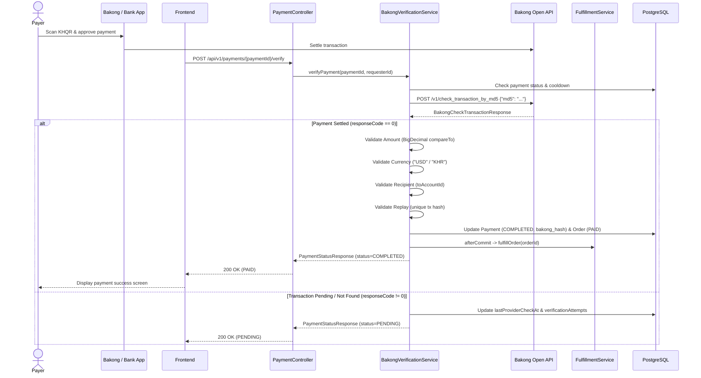
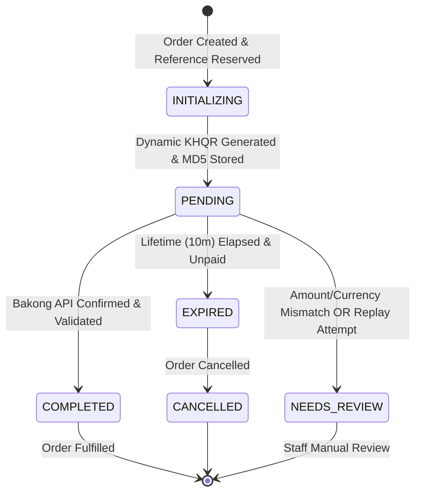

# Bakong KHQR Payment Integration — GameTopUp-KH

This document details the Bakong KHQR (Khmer Quick Response) payment integration for the GameTopUp-KH Spring Boot backend.

---

## 1. Module Architecture

The Bakong integration module is located in `org.example.gametopupkh.payment.bakong`:

```text
payment/bakong/
├── dto/
│   ├── BakongKhqrResponse.java           # DTO containing KHQR payload, MD5, expiration, amount, currency
│   ├── BakongCheckTransactionRequest.java # Request payload ({"md5": "..."}) for check_transaction_by_md5
│   ├── BakongCheckTransactionResponse.java# Typed response from Bakong Open API
│   └── BakongKhqrOrderRequest.java       # Request payload for /api/v1/payments/bakong/khqr
├── BakongProperties.java                 # Configuration properties, domain validation, secret masking
├── BakongKhqrService.java               # EMVCo-compliant dynamic KHQR generator & MD5 hasher
├── BakongApiClient.java                 # HTTP RestClient transport for /v1/check_transaction_by_md5
├── BakongPaymentGateway.java             # Implements PaymentGateway abstraction (active when payment.gateway=bakong)
├── BakongPaymentMapper.java              # Maps Bakong Open API responses to domain PaymentIntents
└── BakongVerificationService.java        # Authoritative transaction verifier, replay preventer, and fulfillment initiator
```

### Architectural Principles

1. **Separation of Concerns**: Generating a dynamic KHQR is not proof of payment. Payment is only confirmed (`PAID`) when verified authoritatively against the Bakong Open API.
2. **Replay Protection**: The returned transaction hash (`data.hash`) is stored in both `payments.gateway_reference` and `payments.bakong_hash`. A database-level partial unique index (`uq_payments_bakong_hash`) strictly prevents reusing a transaction hash across multiple payments or orders.
3. **Double Fulfillment Prevention**: The `COMPLETED` payment status transition is transactional. Automated fulfillment through `FulfillmentService` is triggered only after the transaction commits, using `TransactionSynchronization.afterCommit` in a `REQUIRES_NEW` boundary. Repeated verification calls return the persisted state idempotently without re-triggering fulfillment.
4. **Defense in Depth**: Monetary amount (`BigDecimal.compareTo`), currency ("USD" / "KHR"), receiving account ID (`toAccountId`), and transaction uniqueness are all strictly validated before payment is marked complete. If any validation fails, the payment and order are placed into `NEEDS_REVIEW` for human investigation.
5. **Rate Limiting & Cooldown**: Verification requests are protected by a configurable per-payment cooldown (`payment.reconcile.cooldown`) to protect the Bakong Open API quota and prevent excessive polling.

---

## 2. Configuration & Environment Variables

The following environment variables configure the Bakong integration:

| Environment Variable | Application Property | Default | Description |
| :--- | :--- | :--- | :--- |
| `BAKONG_ENVIRONMENT` | `payment.bakong.environment` | `production` | Environment mode (`production` or `sandbox`). |
| `BAKONG_PAYMENT_ENABLED` | `payment.bakong.enabled` | `false` | Master kill-switch. Keeps live payments disabled until credentials are fully authorized. |
| `BAKONG_BASE_URL` | `payment.bakong.base-url` | `https://api-bakong.nbc.gov.kh` | Base URL for Bakong Open API. Validated against approved NBC domains. |
| `BAKONG_API_TOKEN` | `payment.bakong.api-token` | `""` | Bearer API token obtained from NBC Bakong developer portal. Redacted in logs. |
| `BAKONG_ACCOUNT_ID` | `payment.bakong.account-id` | `""` | Merchant receiving Bakong account ID (e.g. `merchant@bank` or mobile number). |
| `BAKONG_MERCHANT_NAME` | `payment.bakong.merchant-name` | `GameTopUp-KH` | Display name of the store appearing on payer banking apps (max 25 chars). |
| `BAKONG_MERCHANT_CITY` | `payment.bakong.merchant-city` | `Phnom Penh` | Merchant city for EMVCo Tag 60 (max 15 chars). |
| `BAKONG_LIFETIME_MINUTES` | `payment.bakong.lifetime-minutes` | `10` | KHQR expiration window (capped at maximum 10 minutes per Bakong specification). |
| `BAKONG_CONNECT_TIMEOUT` | `payment.bakong.connect-timeout` | `5s` | HTTP connect timeout to Bakong Open API. |
| `BAKONG_READ_TIMEOUT` | `payment.bakong.read-timeout` | `15s` | HTTP socket read timeout. |
| `BAKONG_MAX_RETRIES` | `payment.bakong.max-retries` | `2` | Bounded retries for transient HTTP errors. |

---

## 3. KHQR Generation Flow (EMVCo Specification)

When a customer initiates a top-up with Bakong KHQR:



### EMVCo TLV Format Breakdown:
- **Tag 00** (Payload Format Indicator): `"01"` -> `000201`
- **Tag 01** (Point of Initiation Method): `"12"` (Dynamic QR: amount is pre-filled and locked) -> `010212`
- **Tag 29** (Merchant Account Info - Individual/Solo):
  - Subtag 00: Bakong Account ID (`properties.accountId()`)
- **Tag 52** (Merchant Category Code): `"5999"` (Miscellaneous Retail) -> `52045999`
- **Tag 53** (Transaction Currency): ISO 4217 numeric code (`840` for USD, `116` for KHR)
- **Tag 54** (Transaction Amount): Exact monetary string from the database (e.g. `4.25`)
- **Tag 58** (Country Code): `"KH"` -> `5802KH`
- **Tag 59** (Merchant Name): Registered store name (e.g. `GameTopUp-KH`)
- **Tag 60** (Merchant City): Registered city (e.g. `Phnom Penh`)
- **Tag 62** (Additional Data Field Template):
  - Subtag 01 (Bill Number): Local payment reference or order number
- **Tag 63** (CRC-16 Checksum): 4-digit hexadecimal CRC-16/CCITT-FALSE (poly: `0x1021`, init: `0xFFFF`) calculated over the complete payload including `6304`.

The **QR MD5 hash** is calculated as standard MD5 over the final complete KHQR UTF-8 string (32 lowercase hex characters).

---

## 4. Payment Verification Flow

The customer scans the QR with any Bakong-enabled banking app. The frontend or scheduled worker queries verification:



---

## 5. Payment Status Lifecycle



---

## 6. API Endpoints

### 1. Initialize Bakong KHQR Payment (Path A - Standard Order Context)
`POST /api/v1/orders/{orderId}/payments/bakong`
- **Auth**: `Bearer <customer_token>`
- **Response** (`201 Created`):
```json
{
  "success": true,
  "data": {
    "paymentId": "550e8400-e29b-41d4-a716-446655440000",
    "orderId": "6ba7b810-9dad-11d1-80b4-00c04fd430c8",
    "provider": "BAKONG",
    "reference": "X8K9L2M4N7P1Q5R3T0V6",
    "status": "PENDING",
    "amount": 4.25,
    "currency": "USD",
    "qrString": "00020101021229200016merchant@bank52045999530384054044.255802KH5912GameTopUp-KH6010Phnom Penh62150111ORDER-123456304ABCD",
    "qrMd5": "e4d909c290d0fb1ca068ffaddf22cbd0",
    "expiresAt": "2026-11-02T03:34:00Z",
    "createdAt": "2026-11-02T03:24:00Z"
  }
}
```

### 2. Initialize Bakong KHQR Payment (Path B - Direct Payment Context)
`POST /api/v1/payments/bakong/khqr`
- **Auth**: `Bearer <customer_token>`
- **Request Body**:
```json
{
  "orderId": "6ba7b810-9dad-11d1-80b4-00c04fd430c8"
}
```
- **Response**: `201 Created` with `CreatePaymentResponse`.

### 3. Read Payment by ID
`GET /api/v1/payments/{paymentId}`
- **Auth**: `Bearer <customer_token>` (order owner or `ROLE_ADMIN`)
- **Response**: `200 OK` with `PaymentStatusResponse`.

### 4. Verify Payment with Provider
`POST /api/v1/payments/{paymentId}/verify`
- **Auth**: `Bearer <customer_token>` (order owner or `ROLE_ADMIN`)
- **Response** (`200 OK`):
```json
{
  "success": true,
  "data": {
    "paymentId": "550e8400-e29b-41d4-a716-446655440000",
    "orderId": "6ba7b810-9dad-11d1-80b4-00c04fd430c8",
    "provider": "BAKONG",
    "reference": "X8K9L2M4N7P1Q5R3T0V6",
    "gatewayReference": "b5d8c1e2f3a4b5c6d7e8f9a0b1c2d3e4f5a6b7c8d9e0f1a2b3c4d5e6f7a8b9c0",
    "bakongHash": "b5d8c1e2f3a4b5c6d7e8f9a0b1c2d3e4f5a6b7c8d9e0f1a2b3c4d5e6f7a8b9c0",
    "status": "COMPLETED",
    "amount": 4.25,
    "currency": "USD",
    "paidAt": "2026-11-02T03:25:30Z",
    "expiresAt": "2026-11-02T03:34:00Z",
    "createdAt": "2026-11-02T03:24:00Z",
    "updatedAt": "2026-11-02T03:25:30Z"
  }
}
```

---

## 7. Local Testing & Mocking

All unit, gateway, API, and verification tests run locally without contacting the live NBC Bakong network:

1. **Run All Bakong Module Tests**:
   ```powershell
   .\mvnw test -Dtest=Bakong*
   ```
2. **Run Full Test Suite with Real PostgreSQL Container**:
   ```powershell
   .\mvnw test
   ```

In automated tests:
- `BakongKhqrService` tests mathematical compliance with EMVCo tags, CRC-16, and MD5 hashing.
- `BakongApiClient` uses Spring's `MockRestServiceServer` to test API status codes, error handling, rate limiting, and network timeouts.
- `BakongVerificationService` runs against mocked provider responses, verifying database constraints, atomic status updates, and automated fulfillment invocation.

---

## 8. Production Deployment & Readiness Checklist

Before activating live Bakong payments in production (`BAKONG_PAYMENT_ENABLED=true`):

- [ ] **Rotate Exposed Token**: Request and obtain a newly generated production Bearer token from the NBC Bakong developer portal to replace any previously compromised token.
- [ ] **Confirm Merchant Account Verification**: Ensure NBC has completed mobile KYC / corporate account verification for the receiving Bakong Account ID.
- [ ] **Configure Environment Variables**:
  - `BAKONG_ENVIRONMENT=production`
  - `BAKONG_BASE_URL=https://api-bakong.nbc.gov.kh`
  - `BAKONG_API_TOKEN=<NEW_UNCOMPROMISED_TOKEN>`
  - `BAKONG_ACCOUNT_ID=<VERIFIED_ACCOUNT_ID>`
  - `BAKONG_MERCHANT_NAME=GameTopUp-KH`
  - `BAKONG_PAYMENT_ENABLED=true`
- [ ] **Review Quota & Rate Limits**: Confirm NBC commercial Open API rate limits and ensure `payment.reconcile.cooldown` (default: 30s) prevents quota exhaustion.
- [ ] **Database Migration V13 Verified**: Migration `V13__add_bakong_payment_support.sql` applies successfully, establishing `uq_payments_bakong_hash` and updating `payments_provider_chk`.
- [ ] **Security Review**: Tokens must remain purely on the backend process environment. Never expose `BAKONG_API_TOKEN` to frontend, repository commits, or logs.
